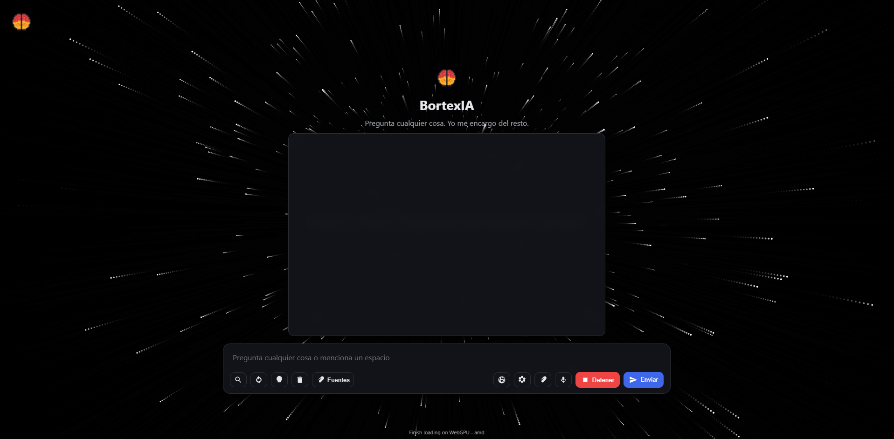

  

  # BortexIA

  ### *Pregunta cualquier cosa. Yo me encargo del resto.*

  **Una experiencia de Inteligencia Artificial 100% local, privada y ejecutada directamente en tu navegador.**

  ---

  
  
  
  

  ---

## 📸 Vista Previa

> Descubre una interfaz futurista, fluida e intuitiva diseñada con un fondo animado interactivo de partículas que reacciona a tu navegación.

  

---

## ✨ Destacados & Capacidades

BortexIA redefine la interacción con modelos de lenguaje de gran tamaño (LLMs) eliminando la necesidad de servidores intermediarios y suscripciones externas.

| Función | Descripción |
| :--- | :--- |
| 🤖 **IA 100% en el Navegador** | Ejecuta modelos LLM potentes aprovechando la potencia gráfica de tu GPU local mediante **WebGPU** y `@mlc-ai/web-llm`. |
| 🔒 **Privacidad Total** | Toda la información y el procesamiento se mantienen dentro de tu dispositivo. Ningún mensaje se transmite a servidores terceros. |
| 🌌 **Interfaz Galáctica Interactiva** | Fondo en tiempo real con dinámicas de partículas en HTML5 Canvas y un diseño *Glassmorphism* elegante y moderno. |
| 💬 **Gestión de Chats & Historial** | Administra múltiples sesiones de chat con guardado automático y persistente en `localStorage`. |
| 📤 **Exportación Multiformato** | Descarga tus conversaciones completas en archivos **Markdown (.md)** o **JSON** estructurados con un solo clic. |
| ⚡ **Desempeño Asíncrono** | Utiliza *Web Workers* en segundo plano para garantizar una interfaz fluida sin interrupciones ni bloqueos de pantalla. |
| 🛠️ **Panel de Herramientas Completo** | Herramientas integradas para búsqueda de conceptos, reformulación de ideas, gestión de fuentes y soporte de voz. |

---

## 🛠️ Tecnologías de Vanguardia

- **Core Intelligence:** `@mlc-ai/web-llm` — Inferencia de modelos LLM acelerados por hardware directo en el cliente.
- **Background Processing:** `Web Workers API` — Manejo del motor de inferencia desacoplado de la interfaz principal.
- **Frontend Architecture:** Vanilla ES Modules, HTML5 Canvas API para renderizado de partículas en 60fps.
- **Visual Design System:** Variables CSS3 avanzadas, efectos de desenfoque de fondo (*backdrop-filter*) y tipografía adaptativa.

---

  Diseñado con pasión para llevar la Inteligencia Artificial Privada al siguiente nivel.

