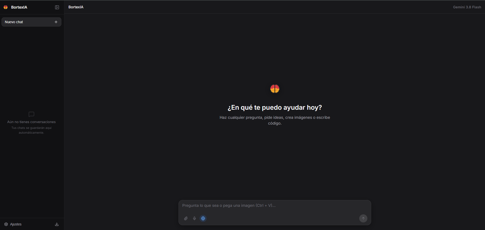

<div align="center">

  

  # BortexIA

  ### *Tu asistente inteligente minimalista, ultrarrápido y sin fricción.*

  **Una experiencia moderna estilo ChatGPT & Perplexity, potenciada por React 19 y motores de IA en la nube 100% gratuitos.**

  ---

  [](#)
  [](#)
  [](#)
  [](#)
  [](#)
  [](#)

</div>

---

## 📸 Galería & Vista Previa

<div align="center">
  
</div>

---

## ✨ Características Principales

* ⚡ **Inferencia Ultrarrápida en la Nube:** Dejó atrás la inferencia local pesada (descargas de 4 GB y saturación de GPU) para responder en milisegundos con 0% de consumo gráfico en tu dispositivo.
* 🌐 **Modo Búsqueda Web (Estilo Perplexity):** Interruptor con el ícono del mundo que activa **Google Search Grounding** para buscar en internet en tiempo real y citar las fuentes con enlaces clicables.
* 🎭 **Modo Incógnito Privado:** Sesiones efímeras y 100% privadas en memoria volátil; ningún mensaje se guarda en el historial ni en el almacenamiento local del navegador al salir.
* 🎨 **Generación de Imágenes 100% Gratuita:** Integra el modelo **Flux** (vía Pollinations.ai) para crear imágenes de alta calidad sin registros ni costos con solo pedir *"Genera una imagen de..."*.
* 📎 **Visión Multimodal:** Sube capturas de pantalla o pégalas directamente desde el portapapeles con `Ctrl + V` para analizar errores, diagramas o fotos con IA.
* 🎙️ **Dictado por Voz Nativo:** Dicta tus preguntas en español utilizando la Web Speech API del navegador en tiempo real.
* 🎬 **Animaciones Fluidas al Estilo GSAP:** Transiciones elásticas y naturales (`cubic-bezier`) en la apertura y cierre del modal, dropdowns y mensajes.
* 📱 **Diseño Dual Responsive:**
  * **Desktop:** Sidebar con dos modos (expandido de 260 px o compacto de 60 px con logo, nuevo chat, ajustes y descarga).
  * **Mobile:** Barra superior táctil con botón de menú, nuevo chat rápido y Drawer flotante nativo con fondo oscuro desenfocado.
* 🗂️ **Historial Inteligente & Exportación:** Agrupación temporal (*Hoy*, *Ayer*, *Últimos 7 días*, *Anteriores*), buscador en vivo y exportación a archivos **Markdown (.md)**.
* 🎨 **Desplegables 100% Personalizados:** Menús flotantes con esquinas redondeadas, sombras y el mismo tono gris `#27272a` del chat.

---

## 🛠️ Stack Tecnológico

| Capa | Tecnología |
| :--- | :--- |
| **Framework Frontend** | [React 19](https://react.dev/) + [Vite](https://vite.dev/) |
| **Gestor de Paquetes** | [pnpm](https://pnpm.io/) |
| **Diseño & Animaciones** | CSS3 Moderno, Variables CSS, Curvas Bezier estilo GSAP |
| **Iconografía** | [Lucide React](https://lucide.dev/) |
| **Renderizado Markdown** | `react-markdown` + `remark-gfm` (código con botón copiar, tablas y citas) |
| **Motores de IA** | [Google Gemini API](https://aistudio.google.com/) (Gemini 2.0 Flash / 1.5 con Grounding) & [Groq Cloud](https://console.groq.com/) (Llama 3.3 70B / DeepSeek R1) |
| **Generación Visual** | [Pollinations.ai](https://pollinations.ai/) (Flux / Stable Diffusion) |

---

## 🚀 Instalación y Puesta en Marcha

### Prerrequisitos
* **Node.js** (v18 o superior)
* **pnpm** (`npm install -g pnpm`)

### 1. Clonar el repositorio
```bash
git clone https://github.com/tu-usuario/BortexIA.git
cd BortexIA
```

### 2. Instalar dependencias con pnpm
```bash
pnpm install
```

### 3. Iniciar el servidor de desarrollo
```bash
pnpm run dev
```

### 4. Compilar para producción
```bash
pnpm run build
```

---

## 🔑 Configuración de las APIs Gratuitas ($0)

BortexIA está diseñado para funcionar con **claves gratuitas que no requieren tarjeta de crédito**:

1. **Google Gemini (Recomendado):**
   * Ingresa a [Google AI Studio](https://aistudio.google.com/app/apikey).
   * Genera tu clave API gratuita (hasta 1,500 solicitudes por día).
2. **Groq Cloud (Opcional - Velocidad Extrema):**
   * Ingresa a [Groq Console](https://console.groq.com/keys).
   * Genera tu clave `gsk_...` (inferencia a 300+ tokens/segundo con Llama 3.3 70B).
3. En **BortexIA**, abre **Ajustes** (ícono de tuerca), pega tu clave y haz clic en **Guardar Cambios**.

---

## 📄 Licencia

Este proyecto se distribuye bajo la licencia **MIT**. Siéntete libre de utilizarlo, modificarlo y adaptarlo a tus necesidades.
